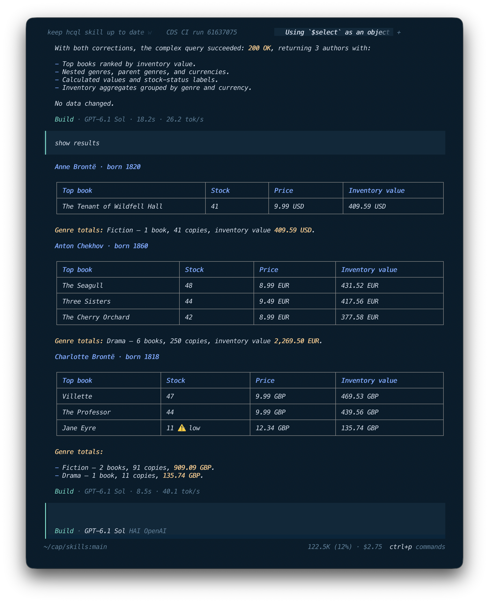

# CAP (H)CQL Voodoo by GPT-6.1

I asked GPT-6.1 the other day to come up with something more challenging to test the latest HCQL adapter with new CQL parser:

> [!question] run a complex read query

... and so they did:

```sql
GET http://localhost:4044/hcql/admin/

-- cql:
SELECT from Authors {
  ID, name, year(dateOfBirth) as birth_year,
  books [
    where stock > ? and price > ?
    order by (stock * price) desc, ID
    limit 3
  ] as top_books {
    ID, title, stock, price, 
    round(stock * price, 2) as inventory_value, 
    case 
      when stock < ? then 'low' 
      else 'available' 
    end as availability,
    genre {
      ID, name, parent { 
        ID, name 
      }
    },
    currency { 
      code 
    }
  },
  books [
    where stock > ? and price > ?
    group by genre.name, currency.code
    having sum(stock * price) > ?
    order by sum(stock * price) desc
    limit 5
  ] as inventory_by_genre {
    genre.name as genre_name, 
    currency.code as currency_code, 
    count(*) as book_count,
    sum(stock) as total_stock, 
    round(avg(price), 2) as average_price, 
    round(sum(stock * price), 2) as inventory_value
  }
}
where exists books [stock > ? and price > ?] and dateOfBirth < ?
order by name, ID
limit 3 

-- args:
[0, 0, 20, 0, 0, 100, 0, 0, '1900-01-01']
```

Which returned this result set:

```js
{ data: [

  {
    ID: 108,
    name: 'Anne Brontë',
    birth_year: 1820,
    top_books: [
      {
        ID: 325,
        title: 'The Tenant of Wildfell Hall',
        stock: 41,
        price: '9.99',
        inventory_value: 409.59,
        availability: 'available',
        genre: {
          ID: '10aaaaaa-aaaa-aaaa-aaaa-aaaaaaaaaaaa',
          name: 'Fiction',
          parent: null
        },
        currency: { code: 'USD' }
      }
    ],
    inventory_by_genre: [
      {
        genre_name: 'Fiction',
        currency_code: 'USD',
        book_count: 1,
        total_stock: 41,
        average_price: 9.99,
        inventory_value: 409.59
      }
    ]
  },
  
  {
    ID: 174,
    name: 'Anton Chekhov',
    birth_year: 1860,
    top_books: [
      {
        ID: 302,
        title: 'The Seagull',
        stock: 48,
        price: '8.99',
        inventory_value: 431.52,
        availability: 'available',
        genre: {
          ID: '11aaaaaa-aaaa-aaaa-aaaa-aaaaaaaaaaaa',
          name: 'Drama',
          parent: {
            ID: '10aaaaaa-aaaa-aaaa-aaaa-aaaaaaaaaaaa',
            name: 'Fiction'
          }
        },
        currency: { code: 'EUR' }
      },
      {
        ID: 280,
        title: 'Three Sisters',
        stock: 44,
        price: '9.49',
        inventory_value: 417.56,
        availability: 'available',
        genre: {
          ID: '11aaaaaa-aaaa-aaaa-aaaa-aaaaaaaaaaaa',
          name: 'Drama',
          parent: {
            ID: '10aaaaaa-aaaa-aaaa-aaaa-aaaaaaaaaaaa',
            name: 'Fiction'
          }
        },
        currency: { code: 'EUR' }
      },
      {
        ID: 278,
        title: 'The Cherry Orchard',
        stock: 42,
        price: '8.99',
        inventory_value: 377.58,
        availability: 'available',
        genre: {
          ID: '11aaaaaa-aaaa-aaaa-aaaa-aaaaaaaaaaaa',
          name: 'Drama',
          parent: {
            ID: '10aaaaaa-aaaa-aaaa-aaaa-aaaaaaaaaaaa',
            name: 'Fiction'
          }
        },
        currency: { code: 'EUR' }
      }
    ],
    inventory_by_genre: [
      {
        genre_name: 'Drama',
        currency_code: 'EUR',
        book_count: 6,
        total_stock: 250,
        average_price: 9.07,
        inventory_value: 2269.5
      }
    ]
  },
  
  {
    ID: 107,
    name: 'Charlotte Brontë',
    birth_year: 1818,
    top_books: [
      {
        ID: 323,
        title: 'Villette',
        stock: 47,
        price: '9.99',
        inventory_value: 469.53,
        availability: 'available',
        genre: {
          ID: '10aaaaaa-aaaa-aaaa-aaaa-aaaaaaaaaaaa',
          name: 'Fiction',
          parent: null
        },
        currency: { code: 'GBP' }
      },
      {
        ID: 324,
        title: 'The Professor',
        stock: 44,
        price: '9.99',
        inventory_value: 439.56,
        availability: 'available',
        genre: {
          ID: '10aaaaaa-aaaa-aaaa-aaaa-aaaaaaaaaaaa',
          name: 'Fiction',
          parent: null
        },
        currency: { code: 'GBP' }
      },
      {
        ID: 207,
        title: 'Jane Eyre',
        stock: 11,
        price: '12.34',
        inventory_value: 135.74,
        availability: 'low',
        genre: {
          ID: '11aaaaaa-aaaa-aaaa-aaaa-aaaaaaaaaaaa',
          name: 'Drama',
          parent: {
            ID: '10aaaaaa-aaaa-aaaa-aaaa-aaaaaaaaaaaa',
            name: 'Fiction'
          }
        },
        currency: { code: 'GBP' }
      }
    ],
    inventory_by_genre: [
      {
        genre_name: 'Fiction',
        currency_code: 'GBP',
        book_count: 2,
        total_stock: 91,
        average_price: 9.99,
        inventory_value: 909.09
      },
      {
        genre_name: 'Drama',
        currency_code: 'GBP',
        book_count: 1,
        total_stock: 11,
        average_price: 12.34,
        inventory_value: 135.74
      }
    ]
  }
]
```

And was presented in OpenCode like that:

Good girl.

P.S. The token and costs displayed in the screenshot – both per task and in total include other effects in that session. The actual ones for that query were ~0.7k tokens, 0.01€. 

P.P.S. No MCP involved — just plain HCQL, and some cql and hcql skills. 
